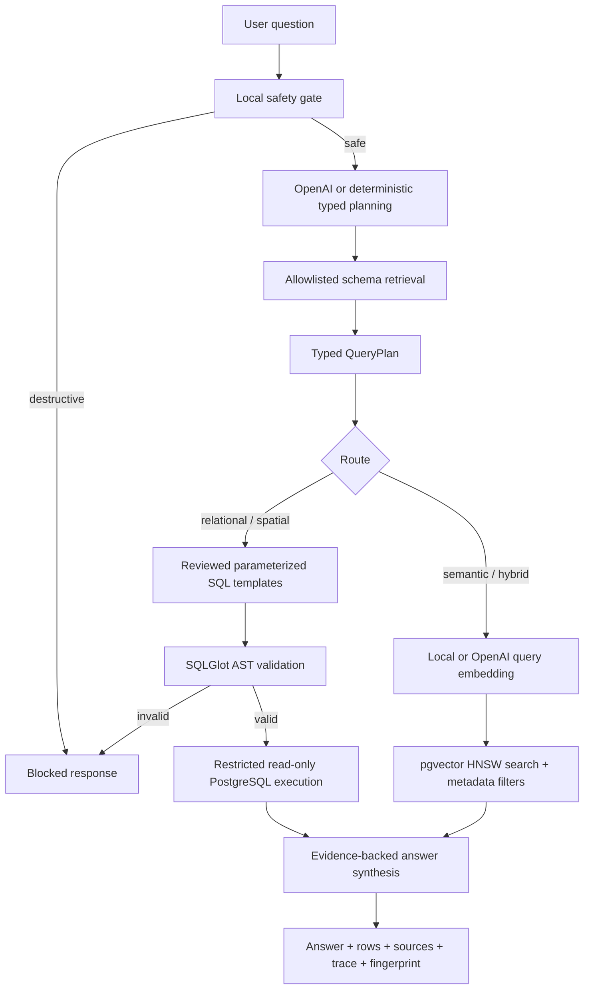

# AgenticDB-SJ v1.0 Architecture

## End-to-end workflow



## Data architecture

```mermaid
flowchart LR
    A[Official public source files] --> RAW[data/raw immutable snapshots]
    RAW --> ETL[Python validation and normalization]
    ETL --> META[metadata source registry + ingestion runs]
    ETL --> CORE[core relational and PostGIS tables]
    CORE --> VIEWS[app allowlisted views]
    CORE --> DOCS[source-derived semantic documents]
    DOCS --> EMB[Local MiniLM and OpenAI embeddings]
    EMB --> PGV[pgvector vector(384) + HNSW]
```

## Safety boundaries

1. Raw API clients submit natural-language questions, never SQL.
2. Destructive requests are blocked before a hosted-model call.
3. The hosted model returns only a strict typed intent and slots.
4. Deterministic code reconstructs the final allowlisted plan.
5. SQL comes from reviewed templates with separate parameters.
6. SQLGlot independently reparses the PostgreSQL AST.
7. Only one bounded `SELECT` statement is eligible.
8. Execution uses `agenticdb_reader` in a read-only transaction.
9. Answers cite returned rows or vector matches only.
10. Tool traces and query fingerprints support auditing.
